# Knowledge Graph Architecture: skilly-ai

> Structural and semantic topology extracted deterministically via AST and import graphs.

## 📈 Graph Metrics
- **Total Entities (Nodes)**: `439`
- **Total Relationships (Edges)**: `1319`
- **Architectural Clusters**: `6`
- **Circular Dependency Cycles**: `0`

**No circular dependency cycles detected.** Codebase dependency graph is acyclic.

## Architectural Clusters & Subdomains

### Skilly_core Domain (`347` components)
- **Key Components**: `start`, `submit`, `ProjectAnalyzer.analyze`, `ManifestExtractor._parse_pubspec`, `_rel`, `PythonASTExtractor.extract`, `ManifestExtractor._parse_requirements_txt`, `sub`, `ManifestExtractor._parse_docker`, `ManifestExtractor._parse_go_mod`
- _...and 337 more components_

### Tests Domain (`78` components)
- **Key Components**: `ProjectAnalyzer.write_artifacts`, `get_cached`, `dumps`, `test_simple_toml_parse_multiline_lists`, `test_analyzer_write_artifacts_respects_no_inject`, `test_python_relative_and_package_imports`, `run_stress_test`, `test_framework_detection_no_false_positives`, `GraphMarkdownGenerator`, `test_ai_injector_preserves_existing_user_content`
- _...and 68 more components_

### Bin Domain (`6` components)
- **Key Components**: `fs`, `bin/skilly-node.js`, `path`, `child_process`, `skilly-node_js`, `skilly_ps1`

### Root Domain (`6` components)
- **Key Components**: `setup.py`, `setuptools`, `start`, `test`, `skilly`, `install.sh`

### .github Domain (`1` components)
- **Key Components**: `generate_project_skills___knowledge_graph`

### Scripts Domain (`1` components)
- **Key Components**: `stress_test_py`

## High-Level Module Architecture Diagram

```mermaid
graph TD
    file_setup_py["setup.py (file)"]
    file_skilly_py["skilly.py (file)"]
    file_scripts_stress_test_py["stress_test.py (file)"]
    file_skilly_core_analyzer_py["analyzer.py (file)"]
    file_skilly_core_cache_py["cache.py (file)"]
    file_skilly_core_cli_py["cli.py (file)"]
    file_skilly_core_config_py["config.py (file)"]
    file_skilly_core_graph_engine_py["graph_engine.py (file)"]
    file_skilly_core_models_py["models.py (file)"]
    file_skilly_core___init___py["__init__.py (file)"]
    file_skilly_core_extractors_base_py["base.py (file)"]
    file_skilly_core_extractors_javascript_extractor_py["javascript_extractor.py (file)"]
    file_skilly_core_extractors_manifest_extractor_py["manifest_extractor.py (file)"]
    file_skilly_core_extractors_polyglot_extractor_py["polyglot_extractor.py (file)"]
    file_skilly_core_extractors_python_extractor_py["python_extractor.py (file)"]
    Path["Path (module)"]
    len["len (module)"]
    append["append (module)"]
    str["str (module)"]
    replace["replace (module)"]
    Skill["Skill (module)"]
    GraphNode["GraphNode (module)"]
    isinstance["isinstance (module)"]
    _rel["_rel (module)"]
    file_skilly_py -->|imports| file_skilly_core_cli_py
    file_scripts_stress_test_py -->|imports| file_skilly_core_analyzer_py
    file_scripts_stress_test_py -->|imports| file_skilly_core_config_py
    file_skilly_core_analyzer_py -->|imports| file_skilly_core_extractors_manifest_extractor_py
    file_skilly_core_analyzer_py -->|imports| file_skilly_core_extractors_python_extractor_py
    file_skilly_core_analyzer_py -->|imports| file_skilly_core_extractors_javascript_extractor_py
    file_skilly_core_analyzer_py -->|imports| file_skilly_core_extractors_polyglot_extractor_py
    file_skilly_core_analyzer_py -->|imports| file_skilly_core_graph_engine_py
    file_skilly_core_analyzer_py -->|imports| file_skilly_core_models_py
    file_skilly_core_analyzer_py -->|imports| file_skilly_core_config_py
    file_skilly_core_analyzer_py -->|imports| file_skilly_core_cache_py
    file_skilly_core_cache_py -->|imports| file_skilly_core_models_py
    file_skilly_core_cli_py -->|imports| file_skilly_core___init___py
    file_skilly_core_cli_py -->|imports| file_skilly_core_analyzer_py
    file_skilly_core_graph_engine_py -->|imports| file_skilly_core_models_py
    file_skilly_core___init___py -->|imports| file_skilly_core_analyzer_py
    file_skilly_core___init___py -->|imports| file_skilly_core_models_py
    file_skilly_core_extractors_base_py -->|imports| file_skilly_core_models_py
    file_skilly_core_extractors_javascript_extractor_py -->|imports| file_skilly_core_extractors_base_py
    file_skilly_core_extractors_javascript_extractor_py -->|imports| file_skilly_core_models_py
    file_skilly_core_extractors_manifest_extractor_py -->|imports| file_skilly_core_extractors_base_py
    file_skilly_core_extractors_manifest_extractor_py -->|imports| file_skilly_core_models_py
    file_skilly_core_extractors_polyglot_extractor_py -->|imports| file_skilly_core_extractors_base_py
    file_skilly_core_extractors_polyglot_extractor_py -->|imports| file_skilly_core_models_py
    file_skilly_core_extractors_python_extractor_py -->|imports| file_skilly_core_extractors_base_py
```

## Central Architectural Hubs (PageRank)

| Rank | Symbol / Module | Type | PageRank | In-Degree | Out-Degree | Impact / Blast Radius |
| :--- | :--- | :--- | :--- | :--- | :--- | :--- |
| #1 | `append` | `module` | `0.0111` | `46` | `0` | Critical Choke Point |
| #2 | `str` | `module` | `0.0090` | `18` | `0` | Critical Choke Point |
| #3 | `GraphNode` | `module` | `0.0088` | `37` | `0` | Critical Choke Point |
| #4 | `Path` | `module` | `0.0087` | `26` | `0` | Critical Choke Point |
| #5 | `isinstance` | `module` | `0.0082` | `14` | `0` | Critical Choke Point |
| #6 | `Skill` | `module` | `0.0078` | `31` | `0` | Critical Choke Point |
| #7 | `_rel` | `module` | `0.0074` | `27` | `0` | Critical Choke Point |
| #8 | `len` | `module` | `0.0073` | `27` | `0` | Critical Choke Point |
| #9 | `replace` | `module` | `0.0068` | `14` | `0` | Critical Choke Point |
| #10 | `models.py` | `file` | `0.0065` | `19` | `18` | Critical Choke Point |
| #11 | `lower` | `module` | `0.0062` | `24` | `0` | Critical Choke Point |
| #12 | `write_text` | `module` | `0.0060` | `18` | `0` | Critical Choke Point |
| #13 | `ProjectAnalyzer` | `module` | `0.0058` | `16` | `0` | Critical Choke Point |
| #14 | `read_text` | `module` | `0.0057` | `23` | `0` | Critical Choke Point |
| #15 | `round` | `module` | `0.0057` | `2` | `0` | High Importance |

## Relationship Types Distribution

| Relationship Type | Count | Description |
| :--- | :--- | :--- |
| `calls` | `922` | Inter-component connection |
| `exposes` | `235` | Inter-component connection |
| `imports` | `148` | Inter-component connection |
| `inherits` | `12` | Inter-component connection |
| `depends_on` | `2` | Inter-component connection |

---
*Interactive visual graph available in `knowledge_graph.html`*